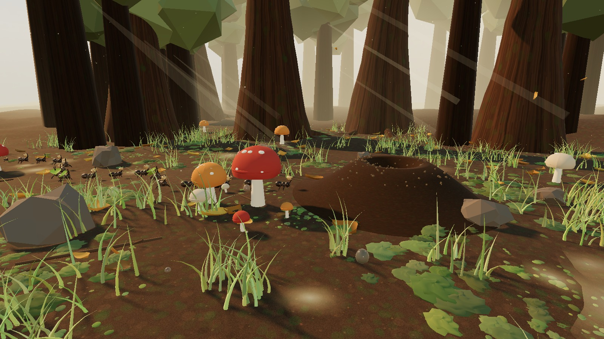
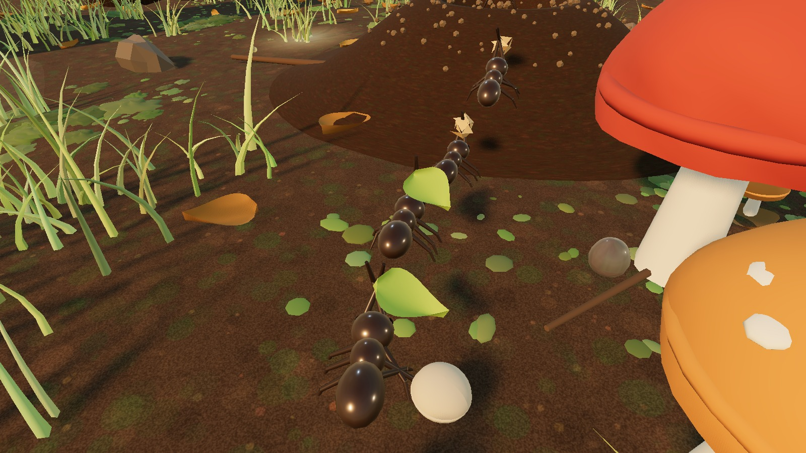
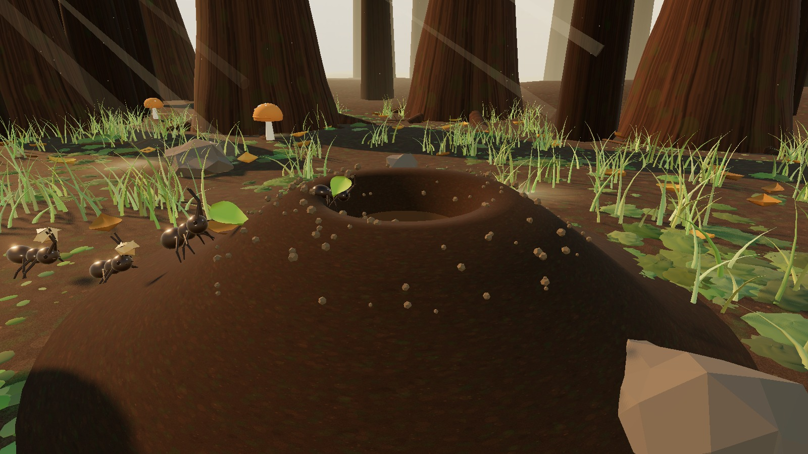
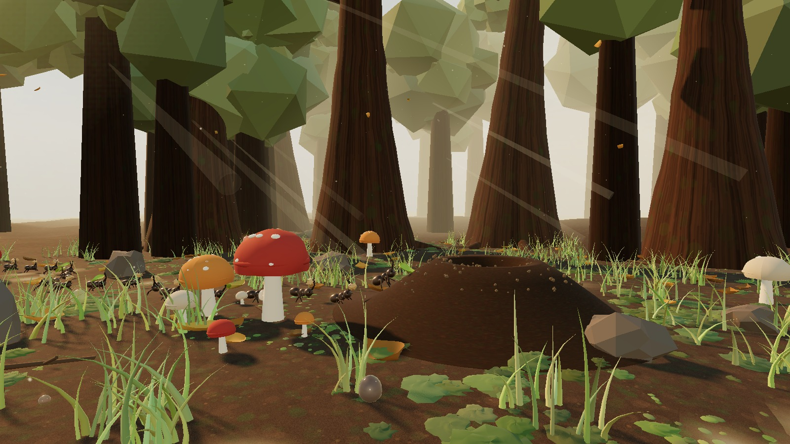
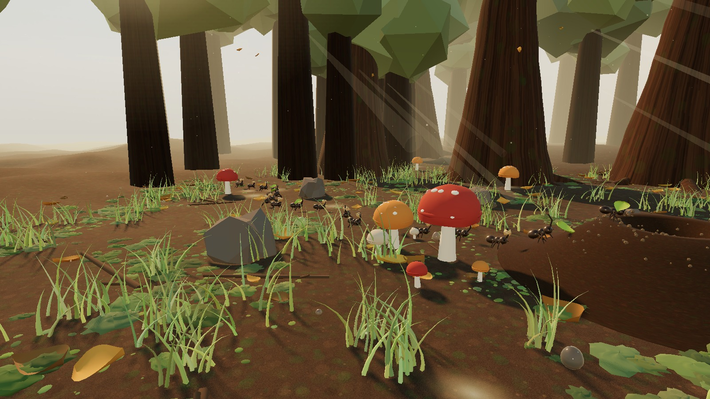
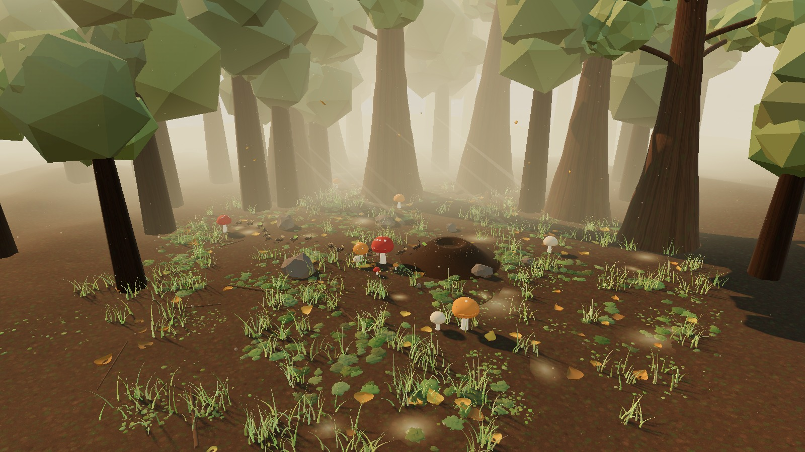

# 晨光森林 · 蚂蚁运粮

一个用 **Three.js r186** 构建的实时 3D 微距森林场景。

清晨的低角度阳光斜穿过高耸的树干，蚂蚁队列扛着食物碎片，沿着气味小径蜿蜒前行，翻过蚁穴的土丘，钻进入口。



**在线体验**：<https://aowind.github.io/forest-ants/>

拖动旋转 · 滚轮缩放 · 右键平移

---

## 它是什么

整个场景是**一个 HTML 文件**，没有任何外部贴图、模型、字体或音频文件。地面、树皮、天空、露珠、苔藓——全部在运行时由代码生成。

| | |
|---|---|
| 几何 | 约 40 万三角面，全部程序化构建 |
| 贴图 | 5 张 Canvas 2D 运行时生成的纹理，可无缝平铺 |
| 外部依赖 | Three.js 一个（CDN importmap） |
| 帧率 | 1600×900 下 70 FPS（集显） |

## 场景里有

- **森林**：6 棵 25 米高的主树（旋转体树干 + 顶点扰动 + 6 条树根 + 9 条树枝 + 108 簇树冠），46 棵远景树用实例化渲染，形成纵深柱廊
- **地被**：2000 株草、3600 粒细苔、1300 块苔藓丘、140 片落叶、26 根枯枝、6 块石头
- **蘑菇**：三色菌盖（红 / 琥珀 / 奶白），半球壳 + 顶点噪声 + 白斑 + 裙边
- **露珠**：透射材质（transmission 0.96 / ior 1.4 / clearcoat），挂在菌盖和草叶上
- **蚁穴**：带实体内壁的土丘，洞口是一段真正的漏斗几何
- **蚂蚁**：18 只，三节躯干 + 六条关节腿 + 触角 + 复眼，各扛一份食物
- **氛围**：低角度暖色平行光、PMREM 环境光、暖雾、树冠间隙的地面光斑、丁达尔光柱、空气浮尘、飘落树叶、太阳眩光



## 三个技术要点

### 1. 零外部资源的材质

所有贴图都用 Canvas 2D 在运行时画出来。地面纹理是「泥土颗粒 + 苔藓斑块 + 枯叶碎屑 + 高频噪声」的叠加，画的时候对每个笔触在 3×3 的偏移位置重复绘制，保证 UV 平铺时没有接缝：

```js
const wrapFill = (cx, cy, r, fill) => {
  for (const dx of [-size, 0, size]) {
    for (const dy of [-size, 0, size]) {
      // 只在与画布相交的位置落笔，越界的笔触会在对面重现
    }
  }
};
```

天空用等距柱状投影的渐变 canvas，同时喂给 `scene.background` 和 `PMREMGenerator`，一份数据解决「看见的天空」和「反射的环境」两件事。

### 2. 蚂蚁真的在爬坡

蚂蚁不是「走到坐标点然后消失」，而是沿着一条高度场走：

```js
function surfaceHeight(x, z) {
  return terrainHeight(x, z) + moundHeight(holeDist(x, z));
}
```

`moundHeight(r)` 用两段剖面做线性插值——土丘外表面（0.60→3.05 米，最高 1.05 米）和洞内漏斗（0.60→0.27 米，深 1.05 米）。实测轨迹：

| 到洞口距离 | 高度 | 状态 |
|---|---|---|
| 4.6 m | 0.26 m | 平地行走 |
| 2.65 m | 0.42 m | 踏上土丘外坡 |
| 1.66 m | 0.94 m | 翻过洞口唇边 |
| 0.03 m | -0.84 m | 已入洞，缩放 0.13 隐藏 |

坡度还会驱动身体俯仰：每帧向前方 0.28 米采样一次高度，用 `atan2(Δy, Δx)` 算出倾角并加到 `body.rotation.z`，上坡时头抬起，下坡时低头。

### 3. 让阳光不穿过树干

丁达尔光柱用圆柱体 + 加法混合实现，但它最初横跨整个场景，视觉上直接「穿过」了树干。修复办法是给每棵树登记水平碰撞体，再沿光柱轴线采样检测：

```js
function beamHitsTree(cx, cy, cz, h) {
  for (let s = -0.5; s <= 0.5; s += 0.07) {
    const px = cx + lightDir.x * h * s;
    const pz = cz + lightDir.z * h * s;
    for (const t of TREE_COLLIDERS) {
      if (Math.hypot(px - t.x, pz - t.z) < t.r + 0.35) return true;
    }
  }
  return false;
}
```

生成时最多重试 90 次，找不到不撞树的位置就跳过这根光柱。光柱长度也从 16–22 米缩到 6–10.5 米，变成树干间隙里的局部柔光，而不是一条横贯画面的白带。

## 更多截图

| | |
|---|---|
|  |  |
| 蚁穴：土丘、洞口与正在攀爬的蚂蚁 | 林间柱廊与斜射光束 |
|  |  |
| 蜿蜒的气味小径 | 场景全貌 |

## 运行

不需要构建工具、不需要 npm install。

```bash
# 任意静态服务器即可
python -m http.server 8000
# 打开 http://127.0.0.1:8000
```

> 直接双击 `index.html` 通常也能跑，但部分浏览器对 `file://` 下的 ES Module 有限制，建议起一个本地服务器。

## 交互

| 操作 | 效果 |
|---|---|
| 拖动 | 环绕旋转 |
| 滚轮 | 缩放（1.2 – 40 米） |
| 右键拖动 | 平移 |
| 「自动环绕」 | 开启/关闭缓慢自转（拖动时暂停，松手 2.5 秒后恢复） |
| 「暂停」 | 冻结所有动画，方便取景 |

## 调试接口

页面暴露了 `window.__forest`：

```js
const { scene, camera, controls, renderer, ants } = window.__forest;
```

## 技术文档

在 AIGPart 社区连带写的实现笔记：

- [开发文档：一片 3D 森林的 AI 协作实录——提示词、模型与 Agent 工具](https://aigpart.com/forum/t/39)
- [零贴图的 3D 森林：用 Canvas 2D 在运行时生成全部材质](https://aigpart.com/forum/t/36)
- [让蚂蚁真的爬进洞里：3D 场景里的高度场物理](https://aigpart.com/forum/t/37)
- [清晨森林的光：实时 3D 场景的光照、雾与体积光管线](https://aigpart.com/forum/t/38)

AIGPart 作品页：<https://aigpart.com/works/forest-ants>

## 技术栈

- **Three.js r186.1** —— 通过 importmap 从 jsDelivr 加载，含 OrbitControls、EffectComposer、UnrealBloomPass、OutputPass
- **Canvas 2D** —— 全部纹理生成
- **ACES Filmic** 色调映射 + 轻度 Bloom

## 已知取舍

- 树冠用低多边形球簇（`IcosahedronGeometry` + `flatShading`），追求风格统一而非写实
- 蚂蚁为 18 只，间距 0.95 米（大于体长 0.55 米），保证不重叠；数量再多需要改成实例化渲染
- 阴影贴图 2048×2048 覆盖 ±16 米，超出范围的物体不投影

## License

MIT
